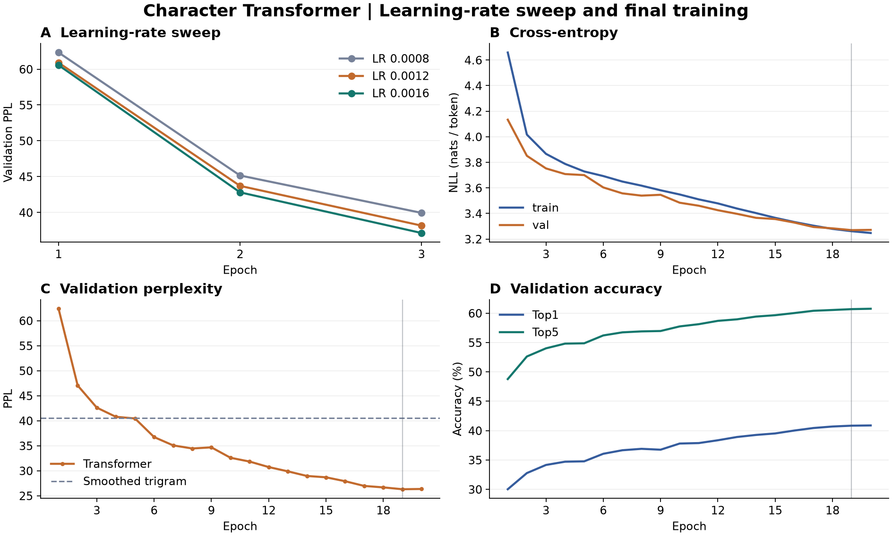

# 第四次作业 · 基于 Transformer 的中文字符语言模型

使用课程中文语料，从随机初始化训练一个 **Decoder-only Transformer**。输入文本前缀后，模型逐字预测并生成后续内容。模型共有 **2,557,824** 个可训练参数。

| 独立测试集 | 结果 |
|---|---:|
| 评估目标数（含 EOS） | 206,660 |
| 字符级 PPL | **26.81** |
| NLL（nat / token） | 3.2888 |
| Top-1 / Top-5 | 40.51% / 60.47% |

[已执行 Notebook](transformer_lm.ipynb) · [最优权重](checkpoints/best.pt) · [测试指标](results/test.json) · [生成记录](results/generation_examples.json)

## 任务与模型

课件第 3、11 页介绍语言模型的链式分解和困惑度，第 22–28 页介绍多头注意力、残差连接与 LayerNorm，第 30 页区分 BERT 和 GPT 的训练目标。本项目沿用课程 RNN 示例的字符级右移标签，将循环层替换为因果自注意力。BERT 材料用于理解 Transformer Block 和双向 MLM。训练权重由本实验从头学习。

给定一行字符，加入句首 `<bos>` 和句尾 `<eos>`。输入 `<bos> 今 天 天 气` 的标签为 `今 天 天 气 <eos>`。位置 $t$ 的 logits 用于预测 $t+1$。因果掩码把 $j>t$ 的注意力分数置为 $-\infty$，因此同一批可以并行监督所有位置，生成时按顺序追加预测字符。

```text
字符 ID + 位置索引
    ↓
字符嵌入 + 可学习位置嵌入   [B, T, 192]
    ↓
4 × Transformer Block
    ├─ LayerNorm → 3 头因果自注意力 → 残差相加
    └─ LayerNorm → 192 → 768 → 192 的 GELU 前馈层 → 残差相加
    ↓
LayerNorm → 共享字符嵌入矩阵的输出投影 → [B, T, 4004]
```

每头维度 64，缩放点积为 $\operatorname{softmax}(QK^\top/\sqrt{64}+M)V$。实现显式投影 Q/K/V，再调用 PyTorch SDPA 执行带掩码的注意力。Pre-LN 和缩放残差分支初始化用于稳定优化，输入与输出共享字表矩阵，省去 768,768 个独立输出权重。模型上下文为 64，dropout 为 0.1。Notebook 验证了替换未来字符后，共享前缀的 logits 保持一致。 [Transformer 原论文](https://arxiv.org/abs/1706.03762) · [BERT 原论文](https://arxiv.org/abs/1810.04805) · [PyTorch SDPA](https://docs.pytorch.org/docs/2.7/generated/torch.nn.functional.scaled_dot_product_attention.html)

## 数据与评估口径

`data/corpus_general.txt.gz` 是课程 `循环神经网络语言模型/corpus_general.txt` 的无损压缩。语料以中文搜索式问句和短句为主。395,286 行经过 NFKC、空白归一化和精确去重后，保留 245,552 行。训练、验证、测试采用约 90% / 5% / 5% 的**分组**划分。忽略标点、空格和大小写后相同的记录进入同一组，切分种子为 42。

| 划分 | 分组 | 行数 | 字符数 | 评估或训练目标数 | 字符 OOV |
|---|---:|---:|---:|---:|---:|
| train | 206,809 | 220,983 | 3,482,170 | 3,703,153 | 0.072% |
| val | 11,489 | 12,265 | 196,006 | 208,271 | 0.084% |
| test | 11,489 | 12,304 | 194,356 | 206,660 | 0.094% |

训练集频次最高的 4,000 个字符与 PAD/BOS/EOS/UNK 组成字表。低频或未见字符映射到 UNK，保留原序列位置。每行独立编码，长行分窗口，相邻窗口共享一个边界字符，所有目标字符和 EOS 都会计入一次。训练时按长度分桶并打乱批次，右侧 PAD 不计入损失。语料与划分的 SHA-256 保存在 [data_stats.json](results/data_stats.json)，评估时和权重内的记录比对。

NLL 是有效位置上真实标签负对数概率的平均值，PPL 为 $\exp(\mathrm{NLL})$。Top-1 和 Top-5 统计真实标签是否落在概率最高的 1 个或 5 个候选中。EOS 和 UNK 参与计分，PAD 被忽略。课件 RNN/LSTM 的分数采用不同的数据划分和字表处理，表中使用同一口径重算的 N-gram 作对照。

## 环境和运行

训练使用 Windows、Python 3.11.13、PyTorch 2.7.1+cu126 和 NVIDIA GeForce RTX 4060 Laptop GPU。CUDA 支持 BF16 时启用混合精度和 fused AdamW。CPU 使用 FP32，适合运行推理、Notebook 和小规模测试。

从 `week04/` 目录运行。以下为 Windows PowerShell 示例。

```powershell
py -3.11 -m venv .venv
.\.venv\Scripts\Activate.ps1
python -m pip install torch==2.7.1 --index-url https://download.pytorch.org/whl/cu126
python -m pip install -r requirements.txt
python -c "import torch; print(torch.__version__, torch.cuda.is_available())"
```

仅使用 CPU 时，将上面的 wheel 索引改为 `https://download.pytorch.org/whl/cpu`。安装后，训练和推理直接读本地数据，不下载模型。 [PyTorch 安装版本说明](https://pytorch.org/get-started/previous-versions/)

```powershell
# 使用随作业提交的最优权重
python predict.py --prompt "如何学习" --seed 42
python predict.py --prompt "我的手机" --temperature 0 --device cpu
python predict.py --evaluate test

# 使用选定配置从头复训，结果写入 runs/retrain/
python train.py --config config.json --device auto --out runs/retrain

# 重跑三组学习率搜索和完整训练，输出到 runs/sweep/
python experiments.py --device auto --out runs/sweep
python predict.py --checkpoint runs/sweep/final/best.pt --evaluate test --json-out runs/sweep/test.json
python baseline.py --checkpoint runs/sweep/final/best.pt --json-out runs/sweep/ngram.json
```

在 VS Code 或 Jupyter 中打开 `transformer_lm.ipynb`，选择安装了 `requirements.txt` 的内核，然后运行全部单元。Notebook 会读取交付日志，重绘曲线，加载交付权重重测完整测试集，并重新生成示例。固定数据划分、初始化与采样种子有助于复现，跨设备、PyTorch 版本和注意力后端可能产生数值与采样差异。用于推理的权重包含模型配置和字表，可以直接拷贝到其他机器。

## 实验结果

用 AdamW、梯度范数裁剪 1.0、250 步线性 warmup 和余弦退火训练。每个 epoch 遍历训练集一次，batch size 为 128，最终学习率衰减到峰值的 10%。以验证 NLL 保存最优轮次，连续 4 轮无改善时停止。

### 学习率搜索

三组共享数据、初始化种子、模型结构、批大小和 3 轮训练预算。按最佳验证 NLL 选出峰值学习率，再从头训练完整模型。

| 峰值学习率 | 最优轮次 | 验证 PPL | 验证 Top-1 |
|---:|---:|---:|---:|
| 0.0008 | 3 | 39.94 | 35.38% |
| 0.0012 | 3 | 38.16 | 35.93% |
| 0.0016 | 3 | 37.13 | 36.24% |

选中的峰值学习率为 **0.0016**。完整训练跑了 20 轮，耗时 265.2 秒（含逐轮验证与存盘）。第 19 轮的验证 PPL 最低，由首轮的 62.38 降到 **26.30**。第 20 轮训练 PPL 继续下降，验证 PPL 小幅回升至 26.35，因此交付第 19 轮权重。短跑和完整训练的余弦衰减跨度不同，因此前几轮的结果可以不同。



### 同口径基线

Unigram 使用加 0.1 平滑。Bigram 和 trigram 递归插值低阶分布，形式为 $(c + \alpha p_{\mathrm{lower}})/(n + \alpha)$，其中 $c$ 是上下文和目标的联合计数，$n$ 是上下文计数。平滑强度从 1、4、16、64、256、1024 中按验证 PPL 选择。Bigram 选中 $\alpha_2=256$，trigram 选中 $(\alpha_2,\alpha_3)=(1024,16)$。测试使用固定权重与参数。

| 模型 | 验证 PPL | 测试 PPL | 测试 NLL |
|---|---:|---:|---:|
| 1-gram | 594.59 | 588.71 | 6.3779 |
| 2-gram | 72.59 | 73.09 | 4.2916 |
| 3-gram | 40.53 | 41.39 | 3.7230 |
| **Transformer** | **26.30** | **26.81** | 3.2888 |

Transformer 相对平滑 trigram 的测试 PPL 下降 **35.22%**。这反映了模型在本语料上对真实后续字符分配了更高的几何平均概率。对照同时改变了上下文长度和模型形式，因此实验无法单独估计长上下文、Pre-LN 或权重共享各自的贡献。训练曲线中的验证值来自 BF16 训练流程，独立测试用 FP32。

### 续写实例

下表来自已执行 Notebook。采样温度 0.85，Top-k 为 40，Top-p 为 0.9。温度设为 0 时每一步选择概率最大的字符。预测 EOS 时立即停止。

| 前缀 | 解码 | 模型新增文本 |
|---|---|---|
| 如何学习 | Greedy | 英语 |
| 如何学习 | 采样，seed 42 | 英语单词 |
| 如何学习 | 采样，seed 43 | 拼音 |
| 我的手机 | 采样，seed 42 | 怎么注册淘宝账户 |
| 今天天气 | 采样，seed 42 | 怎样 |
| 在轨道空间站里 | 采样，seed 42 | 怎么刷金币? |

同一个学习类前缀在不同种子下生成了不同主题。Greedy 生成的「如何学习英语」与训练集整句匹配。空间站前缀被补成了游戏式问句，展示了训练数据中的常见短句模式如何影响少见语境的续写。

## 局限性

- 划分按归一化行的格式变体分组。语义近重复、共享句式和模板仍可能跨集合。结论适用于这份课程语料的同分布评估。
- 64 字符上下文和有限字表适合短续写。超过窗口的前缀会截去更早的部分，生成内容可能跳题、停得过早或复用训练语料表达。
- PPL 和命中率含 EOS，只反映字符预测，无法检验生成文本的事实正确性与段落连贯性。学习率搜索只用单一种子和三个候选点。
- 课程语料随项目附上供复现实验，使用范围以课程要求为准。

## 提交目录

```text
week04/
├── train.py / predict.py            训练与推理、评估入口
├── data.py / model.py               划分、批处理和模型
├── experiments.py / experiment.json 调参协议及入口
├── baseline.py                      同划分的 N-gram 对照
├── config.json / requirements.txt   选定配置和依赖
├── data/corpus_general.txt.gz       课程语料
├── checkpoints/best.pt              验证最优权重、模型配置和字表
├── results/                         实验日志、指标、生成记录和曲线
└── transformer_lm.ipynb / README.md 已执行 Notebook 与说明
```

本次作业提交路径为 `陈泽宇/week04/`。本地重跑输出 `runs/` 由目录内的 `.gitignore` 忽略。交付权重和数据均可用普通 Git 跟踪。 [GitHub 大文件说明](https://docs.github.com/en/repositories/working-with-files/managing-large-files/about-large-files-on-github)
