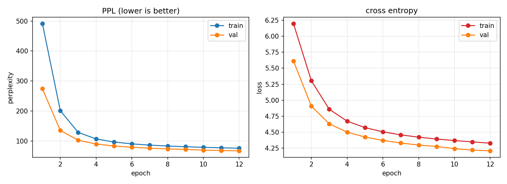

# Week04 作业：用 Transformer 训练字符级语言模型

## 作业要求

课堂 `language_model.py` 用的是 **RNN / LSTM**（`Embedding → RNN/LSTM → Linear`），
作业要求把它换成 **Transformer**，其余部分（字符级数据管道、交叉熵损失、PPL 评估、最优模型保存）保持不变。

## 交付文件

| 文件 | 说明 |
|---|---|
| `transformer_lm.py` | Transformer 版语言模型：训练 + PPL 评估 + 曲线 + 生成/预测演示 |
| `corpus_100k.txt` | 课程 `corpus_general.txt` 的**前 10 万行**（152 万字符），CPU 上跑得完的规模（见下方说明） |
| `best_model_transformer.pt` | 验证 PPL 最低的那一版权重（含字表、超参） |
| `lm_curve.png` | PPL / 交叉熵曲线（train + val） |
| `lm_log.txt` | 12 轮完整训练日志 |

> 语料为什么只取 10 万行：课程全量是 640 万字符，Transformer 在 CPU 上一轮约 4 分钟、12 轮要 50 分钟。
> 默认语料取 152 万字符（一轮 54 秒）。想跑全量：`python transformer_lm.py --corpus corpus_general.txt`。
> 子集就是课程语料的前 10 万行，**行是打乱过的**（不同话题混排），所以取前 10 万行不会只拿到单一主题。

## 相对课堂 RNN 版改了什么

| | 课堂 RNN/LSTM 版 | 本次 Transformer 版 |
|---|---|---|
| 模型 | `Embedding → RNN/LSTM(2 层) → Linear` | `Embedding(+位置编码) → TransformerEncoder × 2 → LayerNorm → Linear` |
| 序列读取 | 按时间步**串行**，天然看不到未来 | 一次**并行**看完 64 个位置，必须手工屏蔽未来 → **因果掩码** |
| 位置信息 | 隐含在 hidden state 的递推里 | 显式加位置编码（默认 BERT 式可学习向量，`--pos sinusoidal` 可换原版 sin/cos） |
| 归一化位置 | 无 | Pre-LN（`--no-norm-first` 可换 BERT 的 Post-LN） |
| 输出层 | `Linear(hidden, V)`，独立参数 | 与词向量**共享权重**（`--no-tie` 可关） |
| 优化器 | Adam | AdamW（权重衰减与梯度解耦）+ 梯度裁剪 1.0 |
| 初始化 | PyTorch 默认 | 标准 Transformer 初始化 N(0, 0.02) |
| 数据管道 / 损失 / PPL / 保存逻辑 | — | **完全沿用，一行没改** |

## 四个关键点

### 1. 因果掩码（不做就是作弊）

Transformer 一次把 64 个位置一起算，位置 i 的注意力能直接读到位置 i+1、i+2……也就是"答案"。
训练时如果让它看见未来，loss 会掉得飞快，但推理时未来还不存在，模型立刻现原形。

做法：构造 `[T, T]` 掩码，右上三角（`j > i`）填 `-inf`，加在注意力分数上：

```
score = QKᵀ / √d + mask      # 未来位置的 score 变成 -inf
w = softmax(score)           # exp(-inf)=0 → 未来位置权重恰好为 0
```

**已验证生效**：把序列第 8 个字符之后的字全部换掉，
- 有掩码时，前 8 个位置的输出最大差异 = **0.0**（完全不受影响）
- 把掩码换成全 0 后，同一实验差异 = **0.30**（未来信息泄漏进来了）

### 2. 位置编码

自注意力是"集合运算"，把「猫追狗」换成「狗追猫」，分数只由两两向量决定，模型自己不知道谁在前。

- `--pos learned`（默认，BERT 做法）：`nn.Embedding(max_len, d)`，第 i 个位置查第 i 行，缺点是不认识超过 max_len 的句子
- `--pos sinusoidal`（原版论文）：`PE[pos,2i]=sin(pos/10000^(2i/d))`，固定公式、可外推，并且按论文做法把词向量先乘 `√d`

### 3. Pre-LN 与 Post-LN

- Post-LN（BERT）：`LayerNorm(x + Sublayer(x))`
- Pre-LN（GPT-2 之后，本作业默认）：`x + Sublayer(LayerNorm(x))`

Pre-LN 把归一化放在子层输入端，残差主路不被归一化，梯度可以一路直通底层，小模型从头训更稳。
代价是**最后一层输出没有 LN 包着**，所以要像 GPT 那样在输出头前补一个 `LayerNorm`。

### 4. 权重共享 + AdamW + 梯度裁剪

- 权重共享：输出层 `fc.weight` 直接指向 `embed.weight`，参数量从 2×V×d 降到 V×d。
  本模型 78.5 万参数里，词向量占 51.2 万 —— 不共享的话这一块要翻倍。
- AdamW：把权重衰减从梯度里解耦（`lr=1e-3, weight_decay=0.01`）。
- 梯度裁剪 1.0：Transformer 偶发梯度尖峰，裁一下更稳。

## 实验设置

| 项目 | 值 |
|---|---|
| 语料 | `corpus_100k.txt`，1,525,933 字符 |
| 词表 | 字符级 4000 个字（沿用课堂） |
| 训练/验证样本 | 22,629 / 1,202（按行打乱后 5% 做验证） |
| 序列设置 | `seq_len=64`，`stride=64`（不重叠切块），`batch=128` |
| 模型 | `d_model=128`，`nhead=4`，`num_layers=2`，`dim_ff=256`，`dropout=0.3` |
| 参数量 | **785,408**（词向量 512,000） |
| 优化 | AdamW，lr 1e-3，weight_decay 0.01，梯度裁剪 1.0 |
| 训练 | 12 epoch，CPU（8 核 16 线程），合计 **671 秒**，约 54 秒/轮 |

## 结果

### 1. 训练过程（12 轮）

| epoch | train PPL | val PPL |
|---|---|---|
| 1 | 491.65 | 274.18 |
| 2 | 201.09 | 135.17 |
| 3 | 128.82 | 102.73 |
| 4 | 106.96 | 90.11 |
| 6 | 90.53 | 79.13 |
| 8 | 83.28 | 73.64 |
| 10 | 79.02 | 69.62 |
| 12 | 75.82 | **67.28** |

随机猜的 PPL 就是词表大小 4000，最终 **67.28** 意味着模型平均在 ~67 个字里就能猜中下一个字，
比随机好 59 倍。曲线仍在缓慢下降，没有过拟合（train PPL 一直高于 val，是 dropout 在训练集上生效的表现）。



### 2. 和 RNN 基线对比（同语料、同切分、同 8 轮）

为了不拿"不同条件"比，用老师原版 `language_model.py`（`--model rnn --stride 64`，其余默认）
在**完全相同的 152 万字符和同一份训练/验证切分**上跑了 8 轮：

| 模型 | 参数量 | 8 轮 val PPL | 12 轮 val PPL |
|---|---|---|---|
| RNN（课堂版，2 层 hidden 256） | 1,770,400 | **63.62** | 未跑 |
| Transformer（本作业） | 785,408 | 73.64 | **67.28** |

结论要说得诚实：**在这个规模下 RNN 反而略好**。原因有三点，都不是"Transformer 不行"：

1. **参数量差距**：RNN 177 万参数 vs Transformer 78.5 万，容量小一半多；
2. **数据量太小**：152 万字符对 Transformer 来说太少，它没有 RNN 那种"顺序递推"的先验，必须从数据里学；
3. **轮数不同**：Transformer 到第 12 轮还在稳定下降（每轮降 2 左右），RNN 到第 8 轮已明显放缓。

这正是课上讲的取舍：RNN 的瓶颈是**串行计算 + 长依赖衰减**，Transformer 的代价是**要更多数据和算力**。
数据量上去、层数加深、有 GPU 并行之后，优势才会翻过来。

### 3. 模型学到了什么

**给定上下文，下一个字的前 5 名**（比自由生成更能看出真实水平）：

```
「今天天气」 → 怎(0.08)  ，(0.06)  ⏎(0.05)  的(0.05)  气(0.03)
「我想去」   → 哪(0.24)  除(0.11)  掉(0.04)  年(0.04)  了(0.03)
「我们明天」 → 天(0.10)  气(0.07)  的(0.06)  ，(0.04)  酷(0.04)
「这部电影」 → ⏎(0.22)  叫(0.13)  ？(0.07)  的(0.06)  是(0.05)
```

（`⏎` 是换行符，说明模型也学会了"这句话该结束了"）

「我想去**哪**」「我们明天**天气**」「这部电影**叫**什么」—— 搭配关系是学到的，不是随机。

**自由生成**（temperature=1.0，60 字）：

```
「人工智能是」→ 人工智能是什么意思
                周杰伦敦煌是尽动被突突暴风力的意思 …
「我想去吃」  → 我想去吃痘如何下载么 …
```

前 6~8 个字基本通顺（「人工智能是什么意思」），后面开始跑偏 —— 这是字符级小模型的典型表现：
局部搭配学会了，长程语义还撑不住。PPL 67 对应的就是这个水平。

## 运行方式

```powershell
# 默认配置（12 轮，约 11 分钟）
python transformer_lm.py

# 换成原版论文写法（sin/cos 位置编码 + Post-LN）
python transformer_lm.py --pos sinusoidal --no-norm-first

# 用课程全量 640 万字语料（CPU 上一轮约 4 分钟）
python transformer_lm.py --corpus corpus_general.txt --epochs 3

# 加大模型
python transformer_lm.py --d_model 256 --nhead 8 --dim_ff 512 --num_layers 4
```

## 踩到的坑

- **`OMP: Error #15`**：Anaconda 环境里 `torch` 和 `matplotlib` 同时加载会撞 OpenMP 运行库，
  脚本开头必须加 `os.environ['KMP_DUPLICATE_LIB_OK'] = 'TRUE'`（且要在 import 之前）。
- **`--stride` 默认值是 1（不是 64）**：第一次跑 RNN 基线时忘了传，样本数被放大 64 倍，
  一轮跑了 20 分钟还没结束。跑基线一定要显式 `--stride 64`。
- **`nn.TransformerEncoderLayer` 给的 `mask` 要是 `-inf` 的 float 矩阵**，不是 bool 矩阵；
  用 bool 会被当成"True 的位置要屏蔽"，很容易搞反方向。
